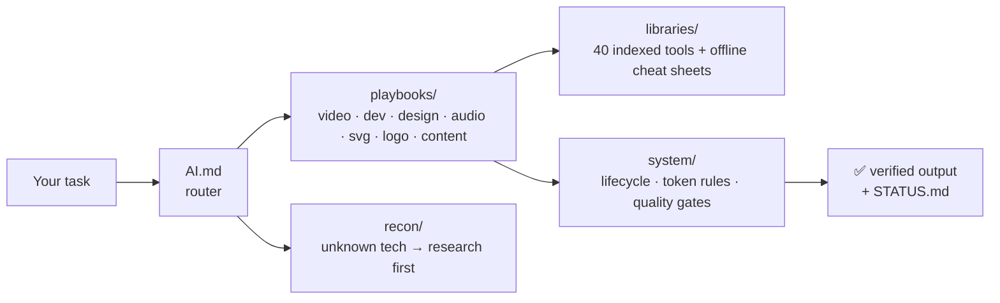

<div align="center">

# 🧠 A.I-essentials

### One folder that turns any AI agent into a disciplined teammate — for code, video, design, audio and research.

[](https://github.com/Sanjayyykumar/ai-essentials/actions/workflows/check.yml)


**Clone it on any laptop, run one command, and every agent you use gets the same skills, tools and rules — planned, verified, cheap on tokens.**

</div>

---

## The problem

AI agents are brilliant and erratic. They re-read your whole repo, guess instead of asking, say "done" without running anything, and forget what they learned last session. Every new tool (Claude, Gemini, Codex, Cursor…) needs the same rules explained again.

## The fix

`ai-essentials` is a small, agent-neutral **operating system in Markdown**: one entry file, a router, playbooks per domain, quality gates, and a curated index of open-source tools. Any agent that can read files can use it.



## What you get

| | |
|---|---|
| 🧠 **Install once, every AI** | `python scripts/bootstrap.py` ends by running `scripts/link.py`, which registers the ≈550-token `KERNEL.md` with Claude Code, Gemini CLI/Antigravity, Codex and Windsurf (marked block, backup, `--unlink` to undo) and installs the `scout`/`builder`/`reviewer` agents. From then on no one has to say "read AI.md". Web apps (claude.ai, ChatGPT, Grok, Kimi, Cursor) get `dist/PASTE-INSTRUCTIONS.md`. |
| 🎚️ **Effort & model routing** | Every task gets a tier (L/M/H/X → effort low/medium/high/max). `python scripts/models.py H` prints the best model per vendor; agents say so in one line when the current model is a poor fit. |
| 🗂️ **Project brain** | `python scripts/project.py init` creates `.ai/` (PROJECT · TASKS · STATUS · DECISIONS · HANDOFF). Tasks need acceptance criteria and a verify command, respect dependencies, and any AI resumes from STATUS + `project.py next`. |
| 🌐 **Universal flow** | Text, images, videos, audio, PDFs or URLs become a spec first, then one path from idea to finished product, with a plain-language mode for non-engineers (`system/05-universal-flow.md`). |
| 🦸 **Superpowers + OpenCodeReview** | Bootstrap installs [Superpowers](https://github.com/obra/superpowers) (brainstorm → plan → sub-agent build → review → finish) for Claude Code, Gemini CLI and Antigravity, and [OpenCodeReview](https://github.com/alibaba/open-code-review) for precise, low-token code review that runs on your current AI (no extra key). PR-review CI: `templates/github/review.yml`. |
| 🎯 **Precision & learning** | A decision procedure, exactness rules and an output contract per deliverable (`system/06-precision.md`); `scripts/learn.py` turns lessons seen 3× into rules; `scripts/evals.py` measures context cost per task type (plus a manual A/B protocol in `evals/`). |
| 🧭 **One entry point** | `AI.md` routes any task to the 1–2 files it actually needs. `CLAUDE.md`, `AGENTS.md`, `GEMINI.md` and `.cursorrules` all point there. |
| 🔁 **A 7-phase lifecycle** | INTAKE → RECON → PLAN → BUILD → VERIFY → DELIVER → LEARN. VERIFY can't be skipped: "done" means it ran, rendered or passed. |
| 🪙 **Token economy** | Grep before read, read ranges, one skill at a time, batch tool calls, summarise long output to `STATUS.md`. |
| 📍 **Live status** | Agents keep `STATUS.md` current (`phase · step x/y · next · blockers · assumptions`), so you can step away and check in. |
| 🎬 **Media studio** | Routing tables for video, image and audio: code-rendered first, GPU kits when an NVIDIA card is present, cloud only when code can't do it. Pairs with [**video-generations**](https://github.com/Sanjayyykumar/video-generations). |
| ✅ **Proof & self-heal** | `python scripts/verify.py` proves work to P0–P2 (structure · guardrails · the project's own build/tests) and writes `.proof/verify.json`. Agents report the level reached, never more, and repair failures without weakening tests. CI runs the same gate on Windows/macOS/Linux; an opt-in Claude self-heal workflow opens a fix PR. Drop-in copies for your projects: `templates/github/`. |
| 🕵️ **Recon mode** | A method for reverse-engineering and evidence-based research when the agent doesn't know the tech. |
| 📚 **Tool library** | `libraries/registry.json` indexes 40 open-source agent skills and tools (Remotion, Manim, Playwright, Chatterbox, humanizer…) with upstream and licence. `python scripts/find.py video` searches it offline. |

## Skills included

15 ready-made [Claude Skills](https://docs.claude.com/en/docs/agents-and-tools/agent-skills/overview) (`skills/`), also readable by any agent:

| Skill | Use it for |
|---|---|
| `engineering-system` | Default workflow for any coding task: inspect first, smallest safe change, evidence-based verification |
| `karpathy-guidelines` | Avoid the classic LLM coding mistakes: over-building, silent assumptions, sprawling diffs |
| `diagnosing-bugs` | A diagnosis loop for hard bugs and performance regressions |
| `grilling` | Stress-test a plan or design with relentless questions |
| `production-readiness` | Evidence-based go/no-go with P0–P3 gaps, staged rollout and rollback |
| `postgres-best-practices` | Schema, indexes, RLS, locking and pooling rules before you write SQL |
| `playwright-cli` | Drive a real browser from the shell to test and reproduce UI bugs |
| `premium-scroll-site` | Scroll-driven landing pages that don't look templated |
| `media-studio` | Route any image/audio/video job to the right engine; brief → build → mix → QC |
| `presenter-voiceover` | Narration that sounds like a presenter: script rules, pause markup, offline Kokoro voice, fit-to-video mix |
| `hyperframes-video` | Motion video from HTML + GSAP, rendered frame-perfect |
| `pixabay-audio` | Find, license-log and mix royalty-free SFX and music |
| `humanize-writing` | Strip AI writing patterns from docs, posts and emails |
| `tool-library` | Find and use the local library of open-source tools |
| `reference-style` | Study reference reels → style sheet for approval → edit your clips in that style (jump cuts, zooms, captions) |

Installed from upstream by the bootstrap: **ui-ux-pro-max** (UX lead), **impeccable** (style guardian), **taste-skill** (kills samey output), **emil-design-eng** (detail designer), **remotion-best-practices / create / render / captions**.

## Quick start — a new laptop in one command

```bash
git clone https://github.com/Sanjayyykumar/ai-essentials
cd ai-essentials
python scripts/bootstrap.py          # Windows without Python: powershell -ExecutionPolicy Bypass -File scripts\setup.ps1
```

It installs only what's missing, then prints a checklist and `READY`:

| | What you get |
|---|---|
| 🛠️ Tools | git, Node, FFmpeg, yt-dlp (winget / brew / apt) |
| 🎬 Video studio | [video-generations](https://github.com/Sanjayyykumar/video-generations) cloned, Python packages, offline Kokoro voice model, HyperFrames warmed up |
| 🧩 Skills | 15 own + 8 external (ui-ux-pro-max, impeccable, taste-skill, emil-design-eng, 4 × Remotion) into `~/.claude/skills` **and** `~/.agents/skills` |
| 🔌 Plugins | Claude Code: karpathy-skills, lemo-opuscar (66 film styles) |
| 🌍 Env | `AI_HUB_ROOT`, `AI_LIBRARY_ROOT`, `VIDEO_ROOT` |

Options: `--full` (clone all 40 indexed repos), `--captions` (Whisper model), `--check` (report only).
Everything comes from **one manifest**, [`libraries/install.json`](libraries/install.json): add a tool, skill or plugin there and every machine gets it on the next run.

**Or just open the folder in your agent.** `CLAUDE.md`, `AGENTS.md`, `GEMINI.md` and `.cursorrules` tell any agent to run the bootstrap on first use, then follow `AI.md`.

## Layout

```
ai-essentials/
├── KERNEL.md          ← always-on rules (≈550 tokens), auto-linked into every AI
├── AI.md              ← router & manual, opened on demand
├── agents/            Claude Code sub-agents: scout (haiku) · builder (sonnet) · reviewer (opus)
├── system/            lifecycle · token economy · live status · quality gates · proof & self-heal · lessons
├── playbooks/         development · video · image · animation · design · logo · svg · audio · content
├── recon/             reverse engineering & deep research method
├── studio/            media system: routing tables, GPU kits, Hugging Face notes, engines/
├── skills/            15 own skills (external ones installed by bootstrap)
├── libraries/         install.json (bootstrap manifest) · registry.json + CATALOG.md (40 tools) · offline cheat sheets
├── templates/         STATUS · PLAN · TASK · HANDOFF · github/ (proof + self-heal CI for your projects)
├── scripts/           bootstrap (one-command setup) · setup.ps1/.sh wrappers · link (register with every AI) · project (.ai brain) · models (tier → model) · tokens (budgets) · doctor · verify (proof gate) · find · status · check · pack
└── vendor/            cloned tool repos (git-ignored, filled by setup --fetch-missing)
```

## Principles

**Inspect first · offline first · smallest safe change · evidence over claims · ask only when a wrong guess is costly.**

## Contributing

New tool? Add it to `libraries/registry.json` and `libraries/CATALOG.md`. New domain? Add `playbooks/<domain>.md`, a router row in `AI.md`, and a gate in `system/03-quality-gates.md`. Run `python scripts/verify.py` before a PR: it must reach P2 (CI enforces it on 3 OSes). See [CONTRIBUTING.md](CONTRIBUTING.md).

## Licence

MIT © [Sanjay Kumar](https://github.com/Sanjayyykumar). Adapted skills keep their original credit and licence — see [THIRD_PARTY_NOTICES.md](THIRD_PARTY_NOTICES.md). Indexed tools are not redistributed; they're cloned from upstream under their own licences.

⭐ If this makes your agent less chaotic, star it so others can find it.
